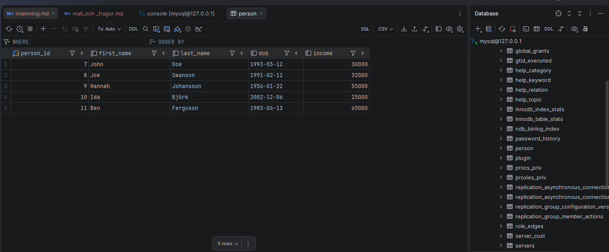
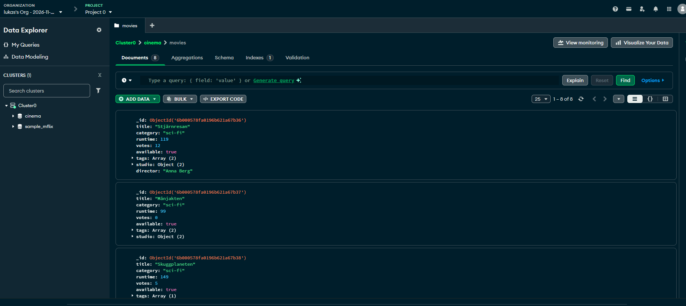
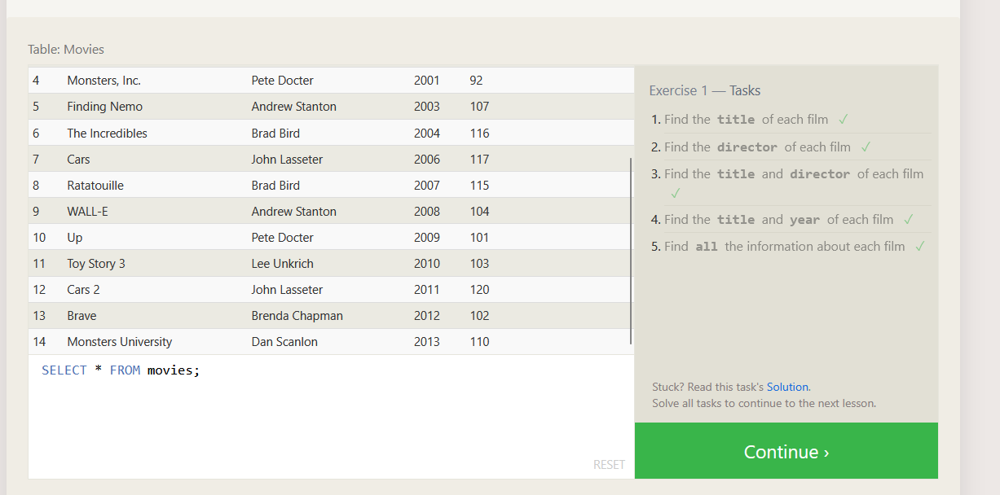
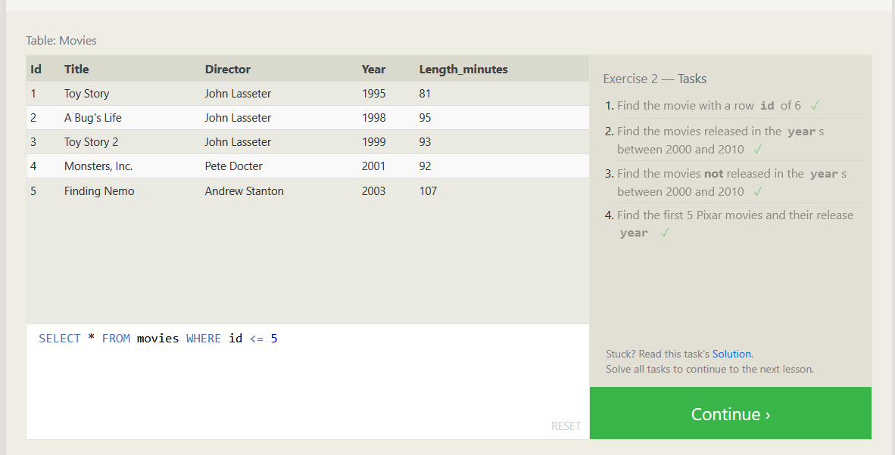

# Labb 1


# MySQL

Skärmdump som visar database explorer i IntelliJ med skapad person-tabell med data:



NOT: Ni ska även ha skapat en user som bara har access till databasen my_database, ingen bild krävs


# MongoDB

Skärmdump av databas på MongoDB Atlas med skapad movie-collection med data:




# SQL

Skärmdump som visar att ni klarat av första två sidorna på sqlbolt.com:s interaktiva tutorial





# Frågor som ni ska svara på (G-nivå)


Besvara frågorna med egna ord. Ge gärna exempel.

## Databaser och verktyg

1. Vad är en databas, och vad kan den användas till?<br>
En databas är ett verktyg vi kan använda oss av för att lagra data utanför våran applikation. Vilket ger oss möjlighet att spara data och använda oss av denna data utöver flera sessioner.
   <br><br>
2. Vad används språket SQL till?<br>
SQL används för att hantera och kommunicera med data i en relationsdatabas. Man kan tillexempel hämta, skapa, updatera, ta bort data med hjälp av SQL i en relationsdatabas.


## Tabeller och relationer

3. Vad är en tabell, en rad och en kolumn? <br>
En tabell är en "huvudgrupp" tillexempel bilar vilket i sin tur då kan innehålla flera rader varav varje rad representerar en bil. Varje bil består av kolumner vilket kan vara bilens olika attribut t.ex. färg eller pris.
<br><br>

4. Vad är en primärnyckel, och varför behövs den? <br>
   En primärnyckel är det som ser till att varje rad har ett unikt sätt att identifieras på. Tillexempel ett uuid eller ett Inkrementellt värde som ser till att två rader inte har samma primary_key värde.
   <br><br>
5. Vad är en främmande nyckel?<br>
En främmande nyckel är en referens till en primärnyckel i en annan tabell. Detta tillåter oss att skapa relationer mellan data i våra tabeller. Tillexempel kan vi ha en tabell som heter "Bilmärken" och en tabell som heter "Bilar". Varav varje record i bilar har en främmande nyckel till en av bilmärkena.
   <br><br>
6. Varför är det bra att lagra kunduppgifter och köp i olika tabeller?<br>
Framförallt för att dem är två olika saker som endast har koppling till varandra. Skulle vi använda oss av en tabell skulle vi dels få blandad data och massvis av onödiga kolumner för varje record. Så om vi har två tabeller skulle vi tillexempelpå ett enkelt sätt hämta en kund och alla dess köp via sin foreign key i köp tabellen i en query. 


## NoSQL

7. Vad menas med NoSQL, och hur kan information organiseras i en sådan databas?<br>
NoSQL är ett samlingsnamn för databaser som inte hanterar data på det tradionella sättet som i relationsdatabaser. Det är istället ett flexibelt sätt att spara data på och som oftast är anpassat för att spara större datamängder. 
Data i en sån databas kan organiseras i key-value pairs, lagra data i json liknande dokument eller kolumnorienterat.
   <br><br>
8. Ge ett exempel på när en NoSQL-databas kan vara lämplig och förklara varför.<br>
En socialmedia platform skulle kunna vara ett exempel. Där inkägg skulle kunna innehålla helt olika saker t.ex. bilder, videor, text, osv... I en dokumnetationsdatabas skulle man tillexempel göra att varje inlägg är ett egen JSON dokument med just dem fält det inlägget behöver. NoSQL skulle också fungera bra i detta exempel då användar mängden blir väldigt hör är det enklare att skala applikationen genom att lägga till flera servrar och fördela datan mellan dem istället. Samanfattat så funkar NoSQL bäst när datan är varierande, mängerna är stora och flexibilitet och skalbarhet väger tyngre än strikta relationer.

## SQL – hämta data från tabellen person

Skriv en SQL-fråga som svar på varje uppgift.

9. Hämta alla kolumner för alla personer i tabellen.<br>
   ` SELECT * FROM person;`
10. Hämta endast förnamn och efternamn för alla personer.<br>
   `SELECT last_name, first_name FROM person;`
11. Hämta förnamn, efternamn och inkomst för personer med en inkomst över 30 000.<br>
   `SELECT last_name, first_name, income FROM person WHERE income > 30000;`
12. Hämta alla personer födda före den 1 januari 1990.<br>
`SELECT * FROM person WHERE dob < '1990-01-01';`

13. Hämta förnamn, efternamn och inkomst, sorterat efter inkomst från högst till lägst.<br>
`SELECT first_name, last_name, income FROM person ORDER BY income DESC;`

14. Räkna hur många personer som finns i tabellen.<br>
`SELECT COUNT(*) from person;`


# VG-nivå


Dessa frågor ska besvaras med ett längre svar, minst en halv A4-sida:

1. En banköverföring avbryts efter att pengarna dragits från det första kontot.
   Vad kan konsekvensen bli, och hur kan en transaktion hjälpa?<br>

Konsekvenserna blir att pengarna blir dragna från det första kontot men pengarna i sig når aldrig det andra kontot. Vilket gör att pengarna försvinner i tomma intet vilket gör att användaren i sig blir av med pengar, mottagaren får aldrig några pengar och banken i sig får fel i sina siffror.

Så om man då i stället använder sig av en transaction så kan man se till att transaktionen antingen blir helt klar och både konto A och konto B får rätt saldo eller så ser man till att både konto A och konto B inte blir påverkade av någon av operationerna som kördes då något gick fel i en av dem.

Detta kan enklast visas med ett kort kodavsnitt:<br>
```sql
BEGIN TRANSACTION;
-- Ta bort 20 från konto A
UPDATE ACCOUNTS SET balance = balance - 20 WHERE account_id = 'A';
-- Lägg till 20 i konto B
UPDATE ACCOUNTS SET balance = balance + 20 WHERE account_id = 'B';
COMMIT;
```
Som vi ser ovan så körs koden och så länge inget går fel så anropas COMMIT kommandot som då ser till att alla ändringar i transaktionen blir sparade till databasen.
Om något skulle gå fel som att databasen ligger nere eller att konto B inte kan ta imot pengarna av någon anledning så körs i stället ROLLBACK. Då ångras alla ändringar i transaktionen och konto A får tillbaka sina 20 kr som att ingenting har hänt.

2. Välj ett enkelt system, antingen en webbutik eller en chatt.
   Resonera om när en relationsdatabas respektive en NoSQL-databas
   kan vara lämplig. Motivera med hur informationen ska lagras och användas. <br><br>
   Om vi använder oss av en webbshop som exempel.
   Vi skulle kunna dela upp den data som finns i en webbshop i en relationsdatabas del och en NoSQL databas del. Där relationsdatabasen kan ta hand om kunder, ordrar, lagersaldo och betalningar. Medan att NoSQL delen kan ta hand om produktkatalogen i sig.<br><br>
   Så varför tar relationsdatabasen hand om de saker jag listade ovan? Jo eftersom detta är delar som vi till 100% ska se likadana ut för varje record. Ta betalningar som ett exempel. I denna tabell vet vi att det alltid kommer behövas en foreign key till en kund, en foreign key till en order, ett betalningsstatus och eventuellt även ett sista betalningsdatum. Här behöver vi också säkerhet genom transactions som vi nämnde i tidigare fråga. Då vi vid skapande av en order till exempel skulle vilja se till att lagersaldot inte är noll. Om det är noll vill vi såklart se till att ordern aldrig skapas och att lagersaldot inte hamnar på minussaldo i detta fall.<br><br>
   Medan att vi kan använda oss av en NoSQL databas för produktkatalogen. Detta eftersom produkter i sig kan ha en stor varians i typen av information den innehåller. Allt från bilder, videor, titel, innehållsbeskrivning, teknisk information, etc…<br><br>
   Detta skulle tillåta att man kan lägga till flera nya produkttyper som har nya fält utan att behöva skapa några migreringar som man skulle behöva i en relationsdatabas. Man undviker även potentiellt att behöva joina data mellan flera tables för att få tag i data då all produktens data ligger under ett dokument i stället. Utöver detta kommer produktkatalogdelen förmodligen bestå av mer trafik än ordersystemet vilket då ger oss en enklare möjlighet att skala upp genom att fördela datan över flera servrar.<br><br>
   Systemen hålls ihop av ett produkt_id. När en kund köper en vara sparas produkt_id och priset på orderraden i relationsdatabasen, medan själva produktinformationen hämtas från katalogen i NoSQL-databasen.


